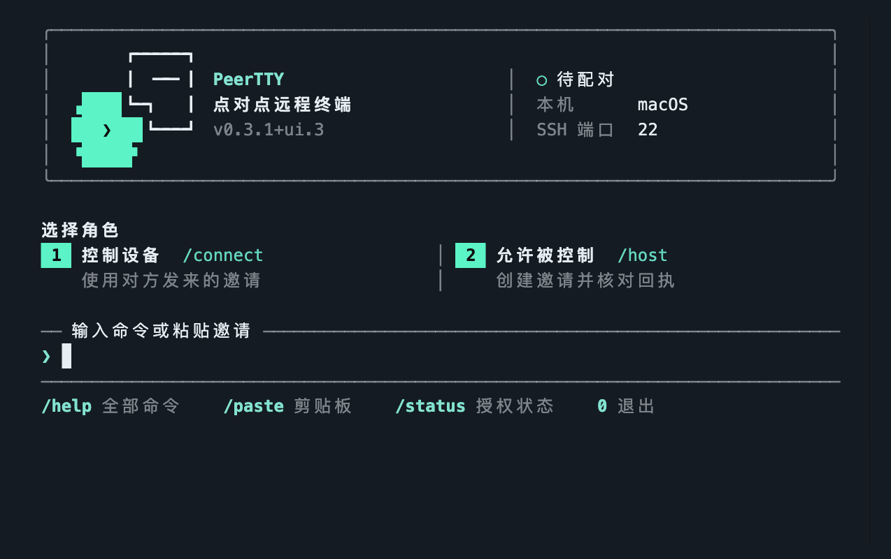

  

<h1 align="center">PeerTTY</h1>

<strong>两台设备之间的限时 SSH 直连</strong>

  <a href="docs/install.md">安装</a> ·
  <a href="#首次连接">首次连接</a> ·
  <a href="docs/usage.md">使用手册</a> ·
  <a href="docs/usage.md#两端都在私网时">连接排查</a>

  

需要帮同事调试一台设备时，双方可以在已有的私聊里交换邀请和回执。设备主人核对控制方和登录账号、在本机批准后，PeerTTY 才建立加密直连。授权期间可以打开多个 SSH 窗口；撤销或到期会一起断开。

  

## 首次连接

两台设备都需要安装 PeerTTY：[macOS](docs/macos.md#安装和启动) · [Windows](docs/windows.md#安装和启动) · [Linux](docs/linux.md#安装和启动)。也可以[从源码安装](docs/install.md#从源码安装)。安装后，两端都在终端运行 `peertty`。

1. **被控方发邀请。** 选 `2 允许被控制`，设置授权时长（默认 1 小时），把邀请私发给控制方。
2. **控制方回执。** 在主菜单粘贴邀请，确认要登录的账号，把生成的回执发回同一私聊。
3. **被控方批准。** 粘贴回执，核对设备和账号，输入 `y`。控制方随即按目标设备的 SSH 登录策略进入终端。

授权有效时，在控制端另开一个窗口运行 `peertty link` 即可再开终端，无需重新配对。输入 `exit` 只关当前窗口；要结束整份授权，在任一端运行 `peertty revoke`。

**网络条件：** PeerTTY 走 UDP 直连，不提供流量中继。两端都在私网时也可以尝试连接，但并非所有 NAT 或防火墙都允许打通。若配对已批准却连不上，先在两端运行 `peertty doctor`，再按[网络自检结果](docs/usage.md#两端都在私网时)排查。

## 深入使用

| 想做什么 | 从这里开始 |
| --- | --- |
| 更换安装方式或自行打包 | [安装与构建指南](docs/install.md) |
| 查看授权状态、重开终端或撤销权限 | [管理一次授权](docs/usage.md#重开终端查看状态和撤销) |
| 在脚本中使用 PeerTTY | [命令行示例](docs/usage.md#脚本用法) |
| 复测覆盖率或验证网络行为 | [单元测试与覆盖率](docs/testing.md) · [双机网络实验](lab/README.md) |
