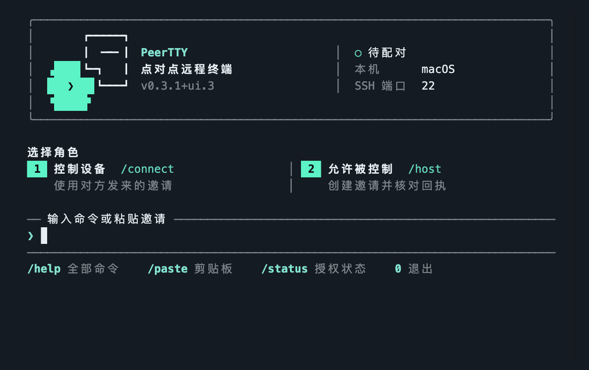

# 使用 PeerTTY

两台设备使用同一个程序。先在控制端和被控端完成安装。[安装指南](install.md)

打开终端，从任意目录输入以下命令。首次启动会生成本机设备身份，以后升级可继续使用同一指纹。

```sh
peertty
```



主菜单选 `1 控制设备` 或 `2 允许被控制`。程序自动检查所选角色需要的 SSH 条件。选 `5 检查本机被控条件` 可以提前检查，选 `4 网络自检` 查看网络，选 `0` 退出。

## 打开一次远程终端

1. 被控方运行 `peertty`，输入 `/host` 或 `2`，填写 **1–24 的整数小时**。回车采用 1 小时。
2. 把邀请发给控制方。桌面终端会尝试自动复制，看到“已复制到系统剪贴板”即可直接在聊天中粘贴。被控端可用 `c` 再复制、`v` 显示全文，也可以发送屏幕上的邀请文件。
3. 控制方运行 `peertty`，粘贴邀请并回车，或用 `/paste` 读取剪贴板。收到文件时选 `1` 并输入路径。回车采用邀请里的账号，把生成的回执发回同一私聊。
4. 被控方粘贴回执或用 `p` 读取，看清控制设备和授权账号后输入 `y`。当邀请提供当前账号登录时，控制方直接进入 SSH，无需输入对方的系统密码。

一次授权绑定一台控制设备，可同时打开最多 32 个 SSH 终端。批准时，签名邀请中的 SSH 主机公钥与签名回执中的登录公钥配对。临时私钥各自留在本机。指定其他账号、使用自定义 SSH 端口、旧版邀请，或本机策略要求多因素认证时，按原有 SSH 方式登录。在账号栏输入 `/ssh` 可以主动选用已有凭据。

## 重开终端、查看状态和撤销

| 想做什么 | 操作 |
| --- | --- |
| 再打开一个 SSH 终端 | 在控制端的新窗口运行 `peertty link`。多个窗口可同时连接。 |
| 从脚本运行命令 | 例如 `peertty link -- hostname`。命令输出和退出码可由调用方读取。 |
| 关闭当前 SSH 窗口 | 输入 `exit`。同一授权下的其他窗口仍可继续工作。 |
| 查看当前授权 | 两端均可重新运行 `peertty`，也可运行 `peertty status` 查看角色、到期时间与连接数。被控端输入 `/host` 可查看活动并找回待发送的邀请。 |
| 结束本次授权 | 被控面板输入 `q`，或在同一设备的任意终端运行 `peertty revoke`。撤销或到期会断开这份授权的全部 SSH 终端，之后再次连接需要新授权。会话中已完成的修改保留。 |
| 调整复制方式 | 主菜单输入 `/clipboard` 切换本次自动复制。无桌面 Linux 可能显示“已向终端发送复制请求”，能否写入由本地终端决定。 |

被控面板的 `b` 返回主菜单，`/quit` 或关闭窗口只关闭界面。两端的限时后台进程维持当前直连。短暂断网时可在状态中看到“等待原路径恢复”。设备重启、后台进程退出或直连彻底中断后，两端结束旧授权，再重新配对。

## 用普通账号运行管理员命令

控制方以被控机批准的系统账号登录。Linux 或 macOS 上需要 `sudo` 时，在当前 SSH 终端按目标机的提示输入密码。用 `sudo -l` 可以查看该账号获准执行的命令。是否提示密码由目标机的 sudo 规则和已有验证记录决定，默认每个终端分别验证。[sudo 验证记录说明](https://man7.org/linux/man-pages/man5/sudoers_timestamp.5.html)

| 场景 | 在控制端运行 |
| --- | --- |
| 从本地终端运行一条需要交互的命令 | `peertty link -t -- sudo -u root id -u`。若系统要求密码，直接在终端输入。 |
| Agent 或脚本在无人值守时运行 | `peertty link -- sudo -n -u root id -u`。需要交互或权限不足时，脚本能收到非零退出码。 |

这两个例子只查询有效用户 ID。返回 `0` 表示这一条命令以 root 执行。其他命令按各自的 sudo 规则判断。`-t` 从控制端 0.3.1 开始支持。被控端使用 Windows 时，管理员权限由 Windows 的账号和 UAC 策略决定。[sudo 手册](https://www.sudo.ws/docs/man/sudo.man/) · [Windows 管理员权限](https://learn.microsoft.com/en-us/windows/security/application-security/application-control/user-account-control/how-it-works)

## 两端都在私网时

菜单 `4 网络自检` 可在配对前单独运行。默认 `auto` 会并行向 Cloudflare 和 Google 查询 UDP 映射，服务会看到本机的出口 IP 和端口。打开主菜单时处于空闲状态。使用内网或自有 STUN 时，两端分别在菜单 `3` 输入可达的 `stun:主机:端口`，多个地址用英文逗号分隔。输入 `none` 仅使用接口地址。设置在本次运行内生效。[Cloudflare STUN 地址](https://developers.cloudflare.com/realtime/turn/) · [WebRTC 项目使用的 Google STUN 地址](https://github.com/webrtc/samples/blob/gh-pages/src/content/peerconnection/trickle-ice/js/main.js)

| 看到什么 | 怎么处理 |
| --- | --- |
| 自检显示“STUN 映射 0” | 查看第一行的服务地址。分处不同私网时，确认两端均能解析并通过 UDP 访问各自的 STUN 服务。设置生效后重新签发邀请。 |
| 两端都有映射，批准后仍未连接 | ICE 会在批准后最多尝试 60 秒，并受授权到期时间限制。确认两端允许双向 UDP 回包。网关按目的地分配不同端口、运营商多层 NAT 或网络封锁时，单有 STUN 映射仍可能失败。可换一个允许直连的网络后重新配对。 |
| 已显示 `udp srflx/srflx` | 两端已通过 STUN 发现的映射地址直连。`host` 表示接口候选，`prflx` 表示对端在 ICE 检查中发现的映射地址。 |
| SSH 提示 `Permission denied` | 已进入 SSH 认证阶段。检查远端系统账号、允许登录的公钥或密码。系统 SSH 首次登录按本机策略核对主机指纹。 |

网络自检只验证本端的地址发现。产品以 ICE 最终选中的候选对报告端到端连接。协议采用 Pion 的 ICE 候选收集、连接检查及重传，诊断方式参考 Tailscale 的 netcheck。当前使用直接 UDP，不配置流量中继或自动路由器端口转发。[Pion ICE](https://github.com/pion/ice/blob/main/gather.go) · [Tailscale netcheck](https://github.com/tailscale/tailscale/blob/main/net/netcheck/netcheck.go) · [双私网实测结果](verification-2026-11-20.md#双私网打洞验收)

## 被控机的 22 端口

选 `2` 或 `5` 后，PeerTTY 自动检查回环端口。已有 SSH 服务可直接使用。22 关闭时程序检查本机 OpenSSH 配置和权限，需要安装组件、生成缺失的主机密钥或取得管理员授权时，会显示对应选项。使用其他 SSH 端口时选“修改本机 SSH 端口”。批准配对后，每次打开终端才接入回环 SSH。使用本次登录公钥时，PeerTTY 为该窗口启动仅绑定回环的原生 OpenSSH，仅读取本次授权的公钥。窗口关闭后回收该实例。系统 SSH 模式优先使用已有服务。

## 脚本用法

网络自检可独立运行。`-require-mapping` 让脚本在收不到 STUN 映射时得到退出码 1。

```sh
peertty doctor -require-mapping
peertty menu -stun none
peertty help
```

使用设备身份文件的脚本可继续调用 `keygen`、`fingerprint`、`host` 和 `connect`。下例第一条在被控机运行，第二条在控制机运行。替换双方指纹、远端账号与设备别名，传递邀请和回执时每轮使用新文件名。

```sh
peertty host -key host.key -peer ENGINEER_FP -offer support-01.offer -ttl 10m
ssh -o ControlPath=none -o "ProxyCommand=peertty connect -key engineer.key -peer HOST_FP -offer support-01.offer -answer support-01.answer" alice@peertty-device01
```

菜单支持 `-state-dir 目录` 或 `-key 已有设备密钥`，控制方可用 `menu -ssh-config 文件` 指定 OpenSSH 配置。[OpenSSH ProxyCommand](https://man.openbsd.org/ssh_config.5#ProxyCommand)
